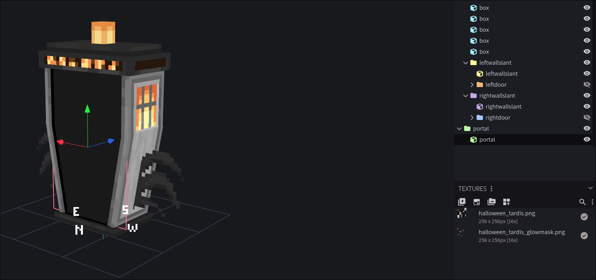

- TOC
{:toc}
* * *

# BOTI
Bigger On The Inside (BOTI) is a feature allowing players to see the interior of the TARDIS from the exterior. 

## Enabling BOTI
To enable BOTI in your game, you need to set `enableBoti` in `dalekmod-common.toml`. 

```toml
[common]
	#Enable bigger on the inside (BOTI) effect. Must be enabled on both client and server to work!
	enableBoti = true

	#The range in blocks the boti portal shows
	botiRadius = 32
```

## Configuring BOTI
Custom exteriors can configure where and how the BOTI effect will render.

There are two ways to configure the boti portal:

### In the Model

You can add a bone with the name `portal` to your geo model; any visible pixels on this bone will be rendered as BOTI, this is useful if your door needs to not be a rectangle.
> 
> BOTI portal on the halloween box. Only the inside is textured, to make the portal fit inside the slanted doors.

### In the JSON

You can also specify the `boti_portal` in the exterior entry JSON; this is useful if you already have a model and don't want to resave it to add a bone.

```json
"boti_portal": {
    "bounds": { //Required: Specify the area where BOTI should render. Can be a list of bounds.
        "x": -1,
        "y": 1.26,
        "z": -0.65,
        "width": 2,
        "height": 0,
        "depth": 1.3
    },
    "facing": "vertical" //Optional: Whether to render the interior vertically or horizontally
}
```

# SOTO
Smaller On The Outside (SOTO) is a feature allowing players to see out of the TARDIS from the inside.

## Enabling SOTO
To enable SOTO in your game, you need to set `enableSoto` in `dalekmod-client.toml`. 
[BOTI must also be enabled](#enabling-boti) in order for SOTO to work.

```toml
[client]
	#[EXPERIMENTAL] Enable smaller on the outside (SOTO) effect. BOTI must also be enabled on both client and server to work!
	enableSoto = true
	#How far away SOTO will render
	sotoRenderDistance = 64
	#The maximum width of SOTO
	sotoMaxWidth = 16
	#The maximum height of SOTO
	sotoMaxHeight = 16
```

## Configuring SOTO

SOTO renders on the TARDIS Exit Void (aka TARDIS Door Hitbox) blocks. Exit voids now a `facing` blockstate to control which side SOTO will render on.

When building interiors, you should make sure that your exit voids are facing in the correct direction in order for SOTO to render correctly; when placing the block, you should be facing towards where the door should be.

